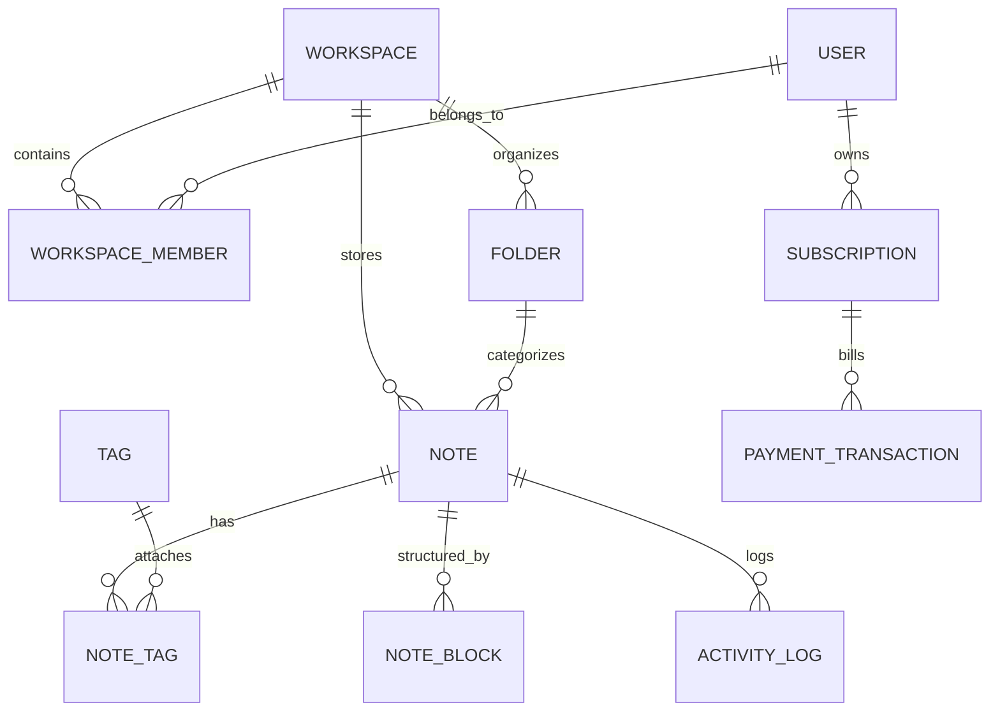

# CloudNote (클라우드노트) 서비스 콘텍스트 및 기능 명세서

본 문서는 `design/` 폴더 내 목업 HTML 디자인 파일(`landing.html`, `auth.html`, `dashboard.html`, `note.html`, `payment.html`, `payment-done.html`)을 정밀 분석하여 작성된 **CloudNote SaaS 서비스의 종합 제품 콘텍스트 및 구현 명세서**입니다.

---

## 1. 서비스 개요 (Service Overview)

### 1.1 서비스 정의
- **서비스명**: CloudNote (클라우드노트)
- **서비스 슬로건**: *"생각을 기록하고, 팀과 실시간으로 연결하세요"*
- **서비스 본질**: **CRDT 기반 실시간 다중 협업**, **오프라인-퍼스트(Offline-First) 동기화**, **내장 AI 지능형 분석**을 결합한 차세대 올인원 마크다운/블록 메모 워크스페이스 SaaS입니다.
- **주요 가치 제안 (Value Proposition)**:
  - 개인에게는 방해 없는 몰입형 글쓰기 환경과 AI 자동 요약/분류 제공
  - 팀에게는 0ms 체감 레이턴시의 실시간 다중 커서 협업과 엔터프라이즈급 E2E(Zero-Knowledge) 보안 제공

### 1.2 타겟 사용자 (Target Audience)
1. **프로덕트 매니저(PM) & 기획자**: 제품 로드맵, PRD, 스프린트 백로그 작성 및 실시간 팀원 피드백 수렴
2. **소프트웨어 & 인프라 엔지니어**: 기술 아키텍처 설계서, API 규격서, 코드 블록 및 KaTeX 수식 작성, 오프라인 환경(이동 중) 작업
3. **UX 리서처 & 디자이너**: 사용자 인터뷰 기록, 리서치 노트 아카이빙, 디자인 시스템 토큰 문서화
4. **스타트업 및 IT 조직**: 분산 근무 환경에서 빠르고 안전하게 지식 자산을 축적하고 공유하려는 테크 팀

---

## 2. 핵심 기술 아키텍처 및 철학 (Core Architectural Pillars)

| 핵심 기술 축 | 기술 설명 및 비즈니스 효과 |
| :--- | :--- |
| **오프라인-퍼스트 (Offline-First)** | 네트워크 연결이 불안정하거나 단절된 환경에서도 SQLite WASM 및 로컬 버퍼를 통해 즉시 작성 가능. 재연결 시 0.1초 내 멱등성(Idempotent) 증분 동기화 수행. |
| **CRDT 실시간 협업** | CRDT (Conflict-free Replicated Data Types) 알고리즘과 WebSocket/WebRTC 저지연 데이터 채널을 통해 수백 명의 동시 편집 세션에서도 텍스트 충돌 없이 자동 병합. |
| **지능형 AI 어시스턴트** | 긴 문서의 핵심 3줄 요약, 액션 아이템 체크리스트 추출, 시맨틱 연관 태그 자동 추천, 기술 문서 내 누락된 보안/체크리스트 자동 감지. |
| **블록 에디터 & 마크다운 호환** | 슬래시(`/`) 명령어를 지원하는 블록 구조와 표준 마크다운(Markdown), 코드 하이라이팅, KaTeX 수식, 표(Table) 등을 자유롭게 조합. |
| **제로 지식 엔드투엔드 보안** | 클라이언트 단말기에서 AES-256 로컬 암호화 후 클라우드로 전송되어, 서버 운영자조차 사용자의 원본 데이터를 열람할 수 없는 제로-놀리지(Zero-Knowledge) 보안 체계. |

---

## 3. 화면별 상세 분석 및 UI/UX 명세

### 3.1 랜딩 페이지 (`design/landing.html`)
서비스의 핵심 가치를 전달하고 무료 체험(14일) 및 구독 전환을 유도하는 공개 마케팅 페이지입니다.

- **네비게이션 바 (GNB)**:
  - 좌측: CloudNote 심볼 로고, 서비스명, 라우트 링크 (홈, 대시보드, 새 노트 작성, 요금제)
  - 우측: `+ 새 노트` 빠른 작성 CTA 버튼, 알림 아이콘, 프로필 썸네일
  - 반응형 글래스모피즘(Backdrop Blur) 상단 고정 헤더
- **히어로 섹션 (Hero Section)**:
  - 뱃지: *"CloudNote 3.0 공식 출시"* (펄스 애니메이션)
  - 헤드카피: *"생각을 기록하고, 팀과 실시간으로 연결하세요"*
  - 서브카피: 마크다운 완벽 지원, AI 지능형 요약, 실시간 클라우드 자동 동기화 설명
  - CTA 버튼: `무료로 시작하기 (14일 체험)` (주요 전환 버튼), `라이브 데모 보기`
  - 신뢰 보증 텍스트: 신용카드 등록 불필요, 언제든 취소 가능, 무제한 로컬 캐싱
- **라이브 프로덕트 인터랙티브 캔버스 목업**:
  - 에디터 상단 바: 맥OS 윈도우 컨트롤 도트, 파일 경로(`workspace/product-spec-v2.md`), 실시간 동기화 상태(0.04s), 협업자 아바타 스택
  - 좌측 탐색기 미리보기: 프로젝트 노트 트리, AI 실시간 보조 알림 카드 (보안 체크리스트 감지)
  - 우측 에디터 캔버스: 태그 칩(#아키텍처 등), 본문, 활성 커서("김민석 PM 편집 중"), 단어 수(1,428단어), AI 요약 완료 뱃지
- **핵심 수치 리본 (Key Metrics)**:
  - 글로벌 가용성 SLA: **99.99%**
  - 동기화 전송 지연 시간: **< 50ms**
  - 매월 생성되는 팀 노트: **450만+**
  - 엔드투엔드 암호화: **256-bit AES**
- **3단 핵심 기능 소개 카드 (Core Features)**:
  1. *초고속 클라우드 동기화*: 오프라인 작업 보장, 0.1초 증분 백업, 성공률 스파크라인 그래프
  2. *AI 지능형 요약 & 자동 분류*: 핵심 요약 추출 및 추천 태그(#전략기획, #스프린트_04) 자동 생성
  3. *블록 에디터 & 마크다운*: 슬래시(`/`) 커맨드, KaTeX 수식, 코드 하이라이팅, 스프레드시트 삽입
- **협업 & 보안 심화 섹션**:
  - 다중 사용자 실시간 락, SHA-256 서명 인증 통과, 지연율 18ms 시각화
  - 가상 팀원(DevOps, Product Designer)의 실시간 코멘트/커서 시뮬레이션
- **소셜 증명 및 고객 리뷰 (Social Proof)**:
  - 평점: 4.9 / 5.0 (5성급)
  - 리뷰 1: 이하은 (핀테크 스타트업 리드 PM) - 스프린트 회의록 AI 자동 정리
  - 리뷰 2: 박준우 (AI 인프라 시니어 엔지니어) - 마크다운/수식 지원 및 KTX 이동 중 오프라인 동기화
  - 리뷰 3: 최서연 (UX Research Lab 디렉터) - 시맨틱 태그 자동 분류와 즉각적인 검색 엔진 속도
- **전환 유도 배너 (Bottom CTA)** & **푸터 (Footer)**:
  - `무료로 워크스페이스 생성` 및 `요금제 비교하기` 버튼
  - 약관, 개인정보처리방침, 고객지원 링크 및 카피라이트

---

### 3.2 통합 인증 페이지 (`design/auth.html`)
로그인과 회원가입을 단일 화면에서 매끄럽게 전환하여 이탈률을 최소화한 인증 화면입니다.

- **좌측 브랜딩 & 스토리텔링 패널 (데스크톱)**:
  - CloudNote 로고, `v2.4 워크스페이스 출시` 뱃지
  - *"생각을 엮고, 아이디어를 현실로."* 비주얼 카피
  - 제품 스크린샷 카드: `⌘K` 스마트 요약 기능 쇼케이스
  - 지표: 120,000+ 활성 팀 워크스페이스, 99.99% 가동률
- **우측 대화형 인증 폼 (Interactive Form)**:
  - **세그먼트 탭 컨트롤러**: `로그인` vs `회원가입` 모드 즉시 전환
  - **소셜 로그인 (OAuth)**: Google로 계속하기, GitHub으로 계속하기
  - **구분선**: "또는 이메일로 계속하기"
  - **입력 필드**:
    - 이름 (회원가입 모드에서만 동적 표시)
    - 이메일 주소 (아이콘 결합 인풋)
    - 비밀번호 (비밀번호 보기/숨기기 토글 아이콘, 비밀번호 찾기 링크)
  - **선택 옵션**:
    - 로그인 모드: "30일간 로그인 상태 유지" 체크박스
    - 회원가입 모드: "서비스 이용약관 및 개인정보 처리방침 동의" 체크박스
  - **제출 버튼**:
    - 로그인 시: `이메일로 로그인 →`
    - 가입 시: `계정 생성하고 시작하기 →`
    - 제출 시 로딩 상태 피드백 ("확인 중...")
  - **하단 모드 전환 헬퍼 텍스트**: "아직 회원이 아니신가요? 무료 회원가입" / "이미 계정이 있으신가요? 로그인"
  - **보안 인증 뱃지**: SOC-2 Type II, ISO 27001 공인 보안, 256-bit TLS 종단간 암호화

---

### 3.3 워크스페이스 대시보드 (`design/dashboard.html`)
로그인한 사용자의 작업 현황, 통계, 노트 목록, 카테고리, 최근 활동을 한눈에 조망하는 메인 허브입니다.

- **좌측 사이드바 (LNB)**:
  - CloudNote 로고 및 워크스페이스 브랜딩
  - `+ 새 노트 작성` 주요 액션 버튼
  - 네비게이션: 대시보드(활성), 노트 작성, 서비스 소개, 요금제 및 구독
  - 하단 사용자 프로필: 아바타, 멤버 등급, 계정 이메일, 설정(`settings`) 바로가기
- **상단 글로벌 헤더**:
  - 통합 검색바: *"노트, 태그, 콘텐츠 검색 (⌘K)"*
  - 빠른 `새 노트` 버튼, 알림 버튼, 프로필 아바타
- **환영 & 상태 배너**:
  - *"Workspace Live • 동기화 완료"* 상태 칩
  - 사용자 맞춤 인사: *"좋은 하루입니다, 서연님! ☀️"*
  - 금일 업데이트된 메모 요약 정보 (3개의 메모 업데이트)
  - 빠른 검색(`⌘K`) 단축키 칩 및 새 노트 작성 CTA
- **4대 메트릭 상태 카드 (Key Metrics Grid)**:
  1. **전체 메모**: 142개 (+14% 증가, 진행률 프로그레스바 72%)
  2. **즐겨찾는 고정 노트**: 12개 중요 보관 (8.4% 비중, 골드 스타 아이콘)
  3. **이번 주 작성 노트**: 8개 신규 (목표 달성 80% 진행률)
  4. **클라우드 저장 용량**: 1.4 GB / 15 GB (사용률 9.3%)
- **최근 열어본 노트 갤러리 (4-Card Asymmetric Layout)**:
  - 카드 구성: 태그(#기획, #인프라, #회의록, #독서노트), 즐겨찾기 별 토글(인터랙티브 클릭 이벤트 지원), 제목, 2줄 본문 요약, 최종 수정 시간("10분 전 수정"), 공동 작업자 아바타 스택
- **우측 사이드 위젯**:
  - **카테고리 폴더 위젯**:
    - 제품 기획 (48개), 개발 아키텍처 (34개), 개인 독서노트 (21개), 회의록 & 미팅 (39개)
    - 새 폴더 생성 아이콘
  - **태그 퀵 필터 위젯**:
    - 총 18개 태그 (#전체, #기획, #스프린트, #아키텍처, #UI/UX, #인사이트, #회의록 등)
- **최근 활동 타임라인 테이블 (Activity Timeline Table)**:
  - 필터: 모든 활동, 내보내기 버튼
  - 테이블 컬럼:
    - *노트 제목*: 문서 아이콘, 제목, 버전 정보, 코멘트 개수
    - *분류 카테고리*: 폴더 뱃지
    - *최종 수정자*: 프로필 썸네일 및 이름
    - *상태*: 동기화 완료(민트), 작성 중(블루), 읽기 전용(그레이)
    - *수정 시간*: 상대 시간 표시 (10분 전, 42분 전 등)
    - *작업*: 더보기(`more_horiz`) 메뉴
- **하단 단축키 & 서버 상태 바**:
  - 지원 단축키: `⌘N`(새 노트), `⌘K`(통합 검색), `⌘/`(AI 도우미 호출)
  - 클라우드 서버 상태: 서울 리전 정상 가동 인디케이터

---

### 3.4 노트 에디터 및 작업 공간 (`design/note.html`)
사용자가 문서를 열람, 편집하고 실시간 협업 및 AI 지원을 받는 핵심 작업 화면입니다.

- **서브헤더 유틸리티 바 (Editor Sub-header)**:
  - 뒤로가기 버튼 (`arrow_back`)
  - 브레드크럼: `내 워크스페이스` > `📁 제품 기획` > `Q4 SaaS 신규 기능 로드맵`
  - 동기화 상태 캡슐: *"방금 전 자동 저장됨 • 842단어 • 읽는 시간 3분"*
  - 유틸리티 액션 그룹:
    - 즐겨찾기 별 토글
    - `AI 생성` 버튼 (자동 생성 및 어시스턴트 호출)
    - 내보내기 버튼 (PDF, Markdown 지원)
    - `공유` 버튼 (팀원 초대 및 링크 공유)
    - 우측 인스펙터 패널 토글 버튼
- **플로팅 블록 포맷 툴바 (Floating Formatting Ribbon)**:
  - 스크롤 시 상단에 고정되는 반응형 툴바
  - 스타일 선택기: 본문 / H1 / H2 / H3
  - 텍스트 서식: 굵게(`⌘B`), 기울임(`⌘I`), 밑줄(`⌘U`), 취소선, 인라인 코드
  - 블록 제어 도구: 글머리 기호, 번호 매기기, 할 일 체크리스트, 인용구, 콜아웃 블록, 코드 블록, 표(Table)
- **문서 캔버스 (Document Canvas - 최대 폭 800px 최적 가독성)**:
  - **커버 이미지**: 건축/인프라 추상 그래픽 배너 (호버 시 '커버 변경', '위치 재조정' 버튼 노출)
  - **문서 대표 이모지**: 대형 아이콘(🚀), 이모지 변경 버튼
  - **메타 뱃지**: 스프린트 태그(`Sprint 26.4`), 우선순위(`우선순위: P0`)
  - **제목 편집 영역**: contenteditable 지원 대형 인라인 제목
  - **메타데이터 태그 바**: `#제품기획`, `#로드맵`, `#v2.4-sync` (태그 삭제 및 추가 가능)
- **본문 리치 블록 구성**:
  1. **AI 자동 요약 콜아웃 블록**: 클라우드엔진 v4 기준 주요 목표 및 아키텍처 변경점 자동 요약
  2. **계층형 헤딩 & 텍스트 블록**: H1, H2 및 세부 본문
  3. **인터랙티브 체크리스트 블록**:
     - 스프린트 마일스톤 할 일 목록 (완료율 동적 계산: 66% 2/3)
     - 완료 항목 체크박스 취소선 및 배포 날짜 메타 정보
     - 진행 중 항목(`Review` 상태 뱃지, PR 링크 연계)
     - 새 태스크 블록 추가 인터랙션
  4. **코드 스니펫 블록 (Syntax Highlighting)**:
     - 맥OS 스타일 창 제어 버튼, 파일명(`SyncCoordinator.ts`), 언어(TypeScript), 코드 복사 버튼
     - 다크 테마 구문 강조 및 CRDT 오프라인 큐 인터페이스 예시 코드
  5. **슬래시(`/`) 명령어 팝오버 메뉴**:
     - `/` 입력 시 호출되는 팝오버 메뉴 (제목 1, 체크리스트, AI 브레인스토밍 등)
  6. **실시간 협업자 아바타 바**:
     - 현재 문서를 동시 편집 중인 멤버 아바타 5명 스택
     - *"실시간 동기화 활성"* 펄스 인디케이터
- **우측 접이식 인스펙터 패널 (Collapsible Inspector Panel)**:
  - 탭: `문서 개요 (TOC)` / `AI 대화`
  - 목차 네비게이션: 클릭 시 본문 해당 헤딩 위치로 스크롤 이동
  - **AI 제안 위젯 (Quick Insights)**: 누락된 섹션(예: 데이터 보안 및 E2E 키 교환)을 감지하고 `보안 섹션 자동 추가` 원클릭 버튼 제공
  - 문서 메타 정보: 최초 생성자, 최종 수정 시간, 동기화 버전 해시(`rev-88402f`)

---

### 3.5 요금제 및 결제 페이지 (`design/payment.html`)
유연한 라이선스 선택과 신속한 구독 결제를 지원하는 상거래(Checkout) 페이지입니다.

- **결제 주기 토글러 (Billing Period Toggle)**:
  - 월간 결제 vs 연간 결제 (20% 할인 뱃지 포함)
  - 토글 시 플랜별 금액 및 결제 드로어의 금액이 실시간으로 상호작용 업데이트
- **3-티어 요금제 카드 비교**:
  1. **Starter (영구 무료 - ₩0)**:
     - 개인 일상 기록 및 아이디어 아카이빙
     - 1GB 클라우드 저장 공간, 기기 최대 2대 동기화
  2. **Pro (가장 인기 - 월 ₩7,900 / 연 결제 시 연 ₩94,800 일괄)**:
     - 무제한 노트 및 문서 생성
     - AI 자동 요약 500회 / 월
     - 무제한 디바이스 동기화, 30일 문서 버전 히스토리 복원, PDF/Web Clipper 무제한
  3. **Team (협업 특화 - 멤버당 월 ₩19,200 / 월 결제 시 ₩24,000)**:
     - 최소 3인 이상 팀 대상
     - 실시간 다중 동시 편집 캔버스, 중앙 관리자 보안 콘솔
     - 세분화된 팀원 권한 및 감사 로그, 팀 전용 무제한 AI 분석, 우선순위 1:1 지원
- **엔터프라이즈 문의 배너**: 100인 이상 대규모 조직 맞춤 라이선스 영업팀 문의 링크
- **결제 정보 입력 드로어 (Right Sticky Checkout Drawer)**:
  - **주문 번호 식별자**: `#CN-89042`
  - **주문 요약 상자**:
    - 선택된 플랜명 및 기본 정가
    - 연간 결제 프로모션 20% 할인액 차감 명시 (-₩24,000)
    - 부가세(VAT 10%) 포함 최종 결제 금액 (₩94,800 / 1년)
  - **결제 수단 탭**: 신용/체크카드, 간편결제(카카오/네이버/토스 등), 실시간 계좌이체
  - **신용카드 입력 폼**:
    - 카드 번호 (16자리 마스킹 포맷)
    - 유효기간 (`MM / YY`) 및 CVC 번호 (3자리 보안 마스킹)
    - 생년월일 6자리 / 사업자등록번호 10자리 (국내 결제 필수 규격)
    - 프로모션 코드 입력 및 적용 버튼
  - **자동 갱신 및 이용약관 동의 체크박스**
  - **결제 실행 버튼**: `₩94,800 결제하기` (클릭 시 스피너 로딩 및 승인 시뮬레이션)
- **신뢰 보증 및 환불 정책**:
  - 7일 무조건 전액 환불 보장, 256-bit 보안 결제망
- **자주 묻는 질문 (FAQ Accordion)**:
  - 플랜 취소/다운그레이드 정책 (계정 설정에서 언제든 해지 가능, 주기 만료 시까지 혜택 유지)
  - AI 기능 사용량 측정 기준 (월 500회 크레딧 및 결제일 초기화)
  - 세금계산서 및 매출전표 지출증빙 발행 안내 (국세청 연동 자동 이메일 발송)

---

### 3.6 결제 완료 및 온보딩 페이지 (`design/payment-done.html`)
결제 성공 후 거래 내역을 증빙하고 유료 플랜 혜택을 즉시 경험하도록 안내하는 페이지입니다.

- **축하 및 완료 배너**:
  - 애니메이션 체크 아이콘 및 스파클 시각 효과
  - 트랜잭션 식별자 칩: `TXN_CONFIRMED • #CN-20261013-8821`
  - 헤드카피: *"결제가 성공적으로 완료되었습니다!"*
  - 퀵 액션: `대시보드로 이동하기`, `새 메모 바로 작성하기`
- **전자 결제 영수증 카드 (Left Receipt View)**:
  - 승인 상태: `결제승인완료` (2026.10.13 22:15:42 KST)
  - 플랜명: CloudNote Pro 연간 결제 (17% 할인 적용)
  - 세부 명세 매트릭스:
    - 주문 번호 (원클릭 클립보드 복사 기능 탑재)
    - 결제 일시 및 결제 수단 (예: 현대카드 4219 일시불)
    - 구독 유효 기간 (2026.10.13 ~ 2027.10.13)
    - 다음 결제 예정일 (자동 갱신 안내 툴팁)
  - 회계 세부 내역: 공급가액(₩86,182) + 부가가치세(₩8,618) - 프로모션 할인(₩19,200) = 최종 결제액(₩94,800)
  - 출력 도구: `영수증 PDF 저장`, `카드 매출전표 출력` (`window.print()` 연동)
- **Pro 온보딩 가이드 (Right Onboarding View)**:
  - 활성화 뱃지: `ACTIVE`
  - 주요 기능 3단계 탐색 카드:
    1. *AI 스마트 자동 요약*: 3줄 요약 및 체크리스트 추출 기능 링크
    2. *대용량 파일 무제한 첨부*: 단일 최대 5GB 파일 업로드 및 에셋 보관
    3. *실시간 공동 작업 워크스페이스*: 팀원 초대 및 커서 공유
  - 단축키 팁: `⌘ + K` 빠른 명령창 안내
- **환불 규정 및 안심 스트립**: 7일 이내 조건 없는 환불 규정 안내, 256-bit SSL, 실시간 자동 백업, 연중무휴 지원 뱃지

---

## 4. 도메인 모델 및 데이터 엔티티 설계 (Domain Entities)

Clean Architecture 원칙에 입각하여 시스템의 핵심 비즈니스 개념을 엔티티로 정의합니다.

### 4.1 핵심 엔티티 정의

#### 1) `User` & `WorkspaceMember`
- `User`: 식별자(`id`), 이메일(`email`), 이름(`name`), 프로필 이미지(`avatarUrl`), 인증 제공자(`provider`: 'EMAIL' | 'GOOGLE' | 'GITHUB'), 생성일시(`createdAt`)
- `WorkspaceMember`: 식별자(`id`), 워크스페이스 ID(`workspaceId`), 유저 ID(`userId`), 역할(`role`: 'OWNER' | 'ADMIN' | 'MEMBER' | 'VIEWER'), 가입일시(`joinedAt`)

#### 2) `Workspace`
- 식별자(`id`), 워크스페이스명(`name`), 소유자 ID(`ownerId`), 슬러그(`slug`), 스토리지 사용량(`storageUsedBytes`), 최대 스토리지 한도(`storageLimitBytes`), 설정(`settings`)

#### 3) `Note` (문서)
- 식별자(`id`), 워크스페이스 ID(`workspaceId`), 폴더 ID(`folderId?`), 제목(`title`), 아이콘 이모지(`iconEmoji?`), 커버 이미지 URL(`coverImageUrl?`), 스프린트 정보(`sprint?`), 우선순위(`priority`: 'P0' | 'P1' | 'P2' | 'NONE'), 즐겨찾기 여부(`isPinned`), 상태(`status`: 'ACTIVE' | 'ARCHIVED' | 'TRASHED'), 동기화 버전 해시(`syncVersion`), 단어 수(`wordCount`), 예상 읽기 시간(`readingTimeMinutes`), 최초 작성자 ID(`authorId`), 최종 수정자 ID(`lastEditedById`), 최종 수정일시(`updatedAt`)

#### 4) `NoteBlock` (블록 에디터 단위)
- 식별자(`id`), 노트 ID(`noteId`), 상위 블록 ID(`parentBlockId?`), 블록 유형(`type`: 'HEADING_1' | 'HEADING_2' | 'PARAGRAPH' | 'CHECKLIST' | 'CODE' | 'CALLOUT_AI' | 'TABLE' | 'DIVIDER'), 순서(`order`), 내용 데이터(`content`: JSON 형태의 텍스트, 속성, 메타데이터), 체크리스트 완료 여부(`isCompleted?`), 